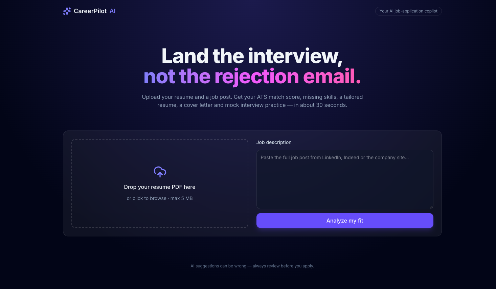
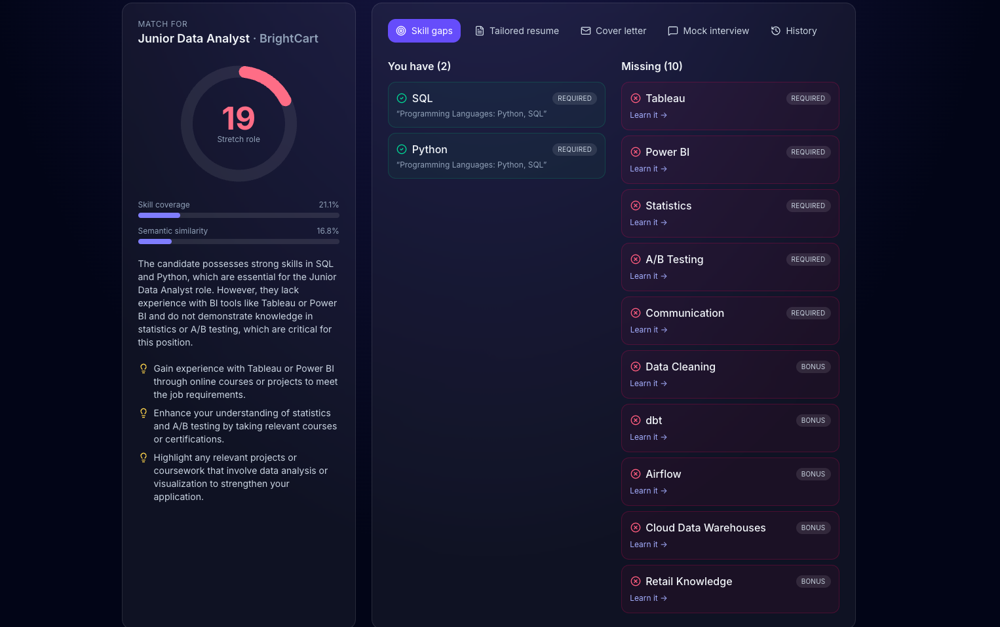
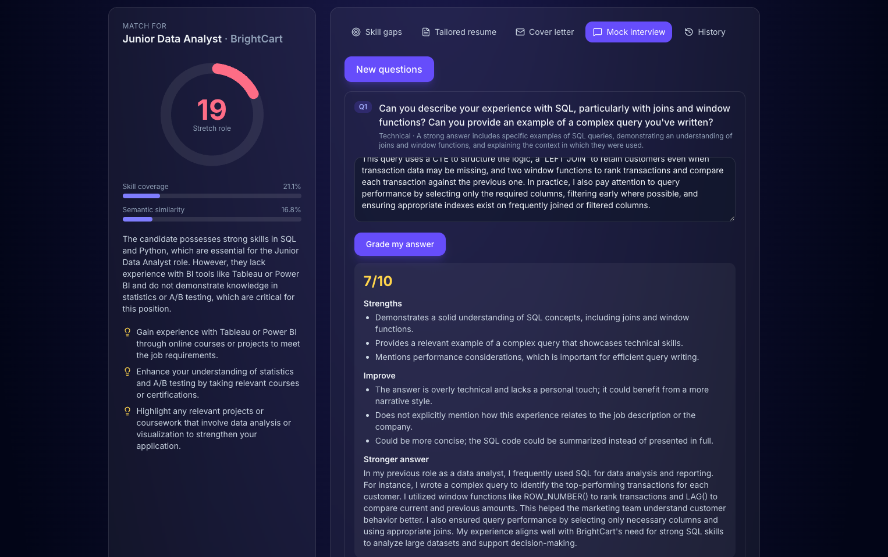
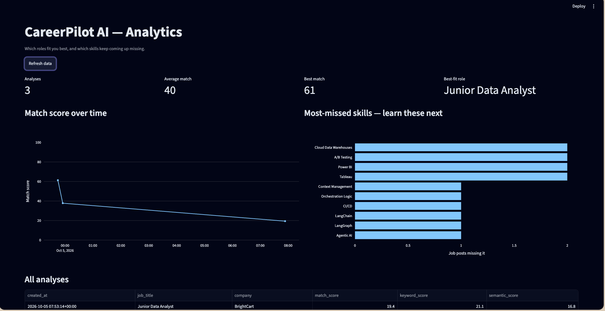
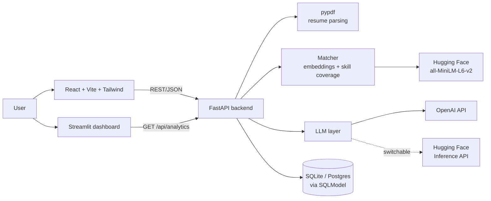

<div align="center">

# ✨ CareerPilot AI

**Your AI job-application copilot.** Upload a resume and a job post, then get an ATS match score, your skill gaps, tailored resume bullets, a cover letter and mock-interview feedback in about 30 seconds.

[](https://github.com/amogh-jadhav/careerpilot-ai/actions/workflows/ci.yml)


<!-- Once deployed, replace with your live links -->
**[Live demo](#)** · **[Analytics dashboard](#)** · **[Report a bug](https://github.com/amogh-jadhav/careerpilot-ai/issues)**



</div>

---

## The problem

- Most large employers screen resumes with **Applicant Tracking Systems (ATS)** before a person reads them. Strong candidates with the wrong keywords get filtered out.
- Tailoring a resume and cover letter for each job takes 1–2 hours, so most people send the same generic version everywhere.
- Students and career-switchers often can't tell which skills a role really expects, or how to prepare for its interview questions.

**CareerPilot AI** brings that work down to under a minute per job, and shows you exactly what to learn next.

## Features

| | Feature | How it works |
|---|---|---|
| 📄 | **Resume parsing** | Extracts text from PDF resumes with `pypdf` |
| 🎯 | **Match score (0–100)** | Blends Hugging Face sentence-embedding similarity (40%) with importance-weighted skill coverage (60%) |
| 🧩 | **Skill-gap report** | LLM extracts required skills from the job post; a regex check cross-verifies them against the resume |
| ✍️ | **Tailored resume bullets** | Rewrites your 6 most relevant bullets in the job's language without inventing experience (unknown numbers become `[X]`) |
| 💌 | **Cover letter** | 250-word letter in a tone you choose, ready to copy or download |
| 🎤 | **Mock interview** | Role-specific technical and behavioral questions, each answer graded 1–10 with a stronger STAR-format sample |
| 📊 | **Analytics dashboard** | Streamlit + Plotly view of your scores over time and the skills you miss most often |

## Screenshots

| Results | Mock interview | Dashboard |
|---|---|---|
|  |  |  |

## Architecture



The browser only ever talks to FastAPI, so API keys stay on the server.

## Tech stack

| Layer | Technology |
|---|---|
| **LLM** | OpenAI API (default) or Hugging Face Inference API, switchable with one environment variable |
| **Embeddings** | `sentence-transformers/all-MiniLM-L6-v2` (local CPU) or the Hugging Face API |
| **Backend** | FastAPI, Uvicorn, Pydantic, SQLModel, SQLite |
| **Frontend** | React 19, Vite, Tailwind CSS v4, Recharts, lucide-react |
| **Dashboard** | Streamlit, Plotly, pandas |
| **Testing / CI** | pytest with a mocked LLM, GitHub Actions |

## Project structure

```text
careerpilot-ai/
├── backend/            FastAPI app (routes, LLM client, prompts, matcher, DB)
│   ├── app/
│   └── tests/
├── frontend/           React single-page app
│   └── src/components/
├── dashboard/          Streamlit analytics
├── samples/            Sample resume PDF + job description for testing
├── docs/screenshots/
└── .github/            CI workflow and issue templates
```

## Getting started

### Prerequisites

- Python **3.12** and Node.js **20+** (on macOS: `brew install python@3.12 node`)
- An [OpenAI API key](https://platform.openai.com/api-keys), or a free [Hugging Face token](https://huggingface.co/settings/tokens)

### 1. Clone

```bash
git clone https://github.com/amogh-jadhav/careerpilot-ai.git
cd careerpilot-ai
```

### 2. Backend → http://localhost:8000/docs

```bash
cd backend
cp .env.example .env          # then add your OPENAI_API_KEY to .env
python3.12 -m venv .venv
source .venv/bin/activate     # Windows: .venv\Scripts\activate
pip install -r requirements.txt
uvicorn app.main:app --reload --port 8000
```

### 3. Frontend → http://localhost:5173

```bash
cd frontend
cp .env.example .env
npm install
npm run dev
```

### 4. Dashboard (optional) → http://localhost:8501

```bash
cd dashboard
python3.12 -m venv .venv
source .venv/bin/activate
pip install -r requirements.txt
streamlit run app.py
```

To try it right away, upload `samples/sample_resume.pdf` and paste `samples/sample_job_description.txt`.

### Free mode (no OpenAI)

In `backend/.env` set `LLM_PROVIDER=huggingface` and `HF_TOKEN=hf_...`, then restart the backend.

## API

Interactive docs are at `/docs` while the backend is running.

| Method | Endpoint | Purpose |
|---|---|---|
| GET | `/api/health` | Health check |
| POST | `/api/analyze` | Resume PDF + job description → score, skills, summary, tips |
| POST | `/api/tailor` | Tailored headline and bullets |
| POST | `/api/cover-letter` | Cover letter in a chosen tone |
| POST | `/api/interview/questions` | Role-specific interview questions |
| POST | `/api/interview/grade` | Score and feedback for an answer |
| GET | `/api/history` | Last 50 analyses |
| GET | `/api/analytics` | All analyses with skill lists (used by the dashboard) |

## How the match score works

```text
semantic = mean over job-post chunks of the best cosine similarity with any resume chunk (rescaled to 0–100)
keyword  = weighted share of required skills found in the resume (must-have = 2, nice-to-have = 1)
score    = 0.4 × semantic + 0.6 × keyword
```

Embeddings catch paraphrases ("built dashboards" ≈ "data visualization"), and keyword coverage reflects how real ATS filters behave.

## Running tests

```bash
cd backend
source .venv/bin/activate
python -m pytest -q
```

The tests replace the LLM with a fake, so they run offline and cost nothing. GitHub Actions runs them, plus a frontend production build, on every push.

## Roadmap

- [ ] User accounts so each person sees only their own history
- [ ] Export the tailored resume as `.docx`
- [ ] Paste a job URL instead of the full text
- [ ] Stream cover letters token by token
- [ ] Voice mock interviews with speech-to-text
- [ ] Browser extension that scores any LinkedIn job you're viewing

## Privacy

The full resume text is never saved to the database. History keeps only the job title, scores, skill names and the AI's analysis. AI output can be wrong, so always review it before you apply.

## License

Released under the [MIT License](LICENSE).

## Author

**Amogh Jadhav** · [GitHub](https://github.com/amogh-jadhav) · [LinkedIn](https://www.linkedin.com/in/amogh-jadhav-16070321a)

If this project helped you, consider giving it a ⭐
